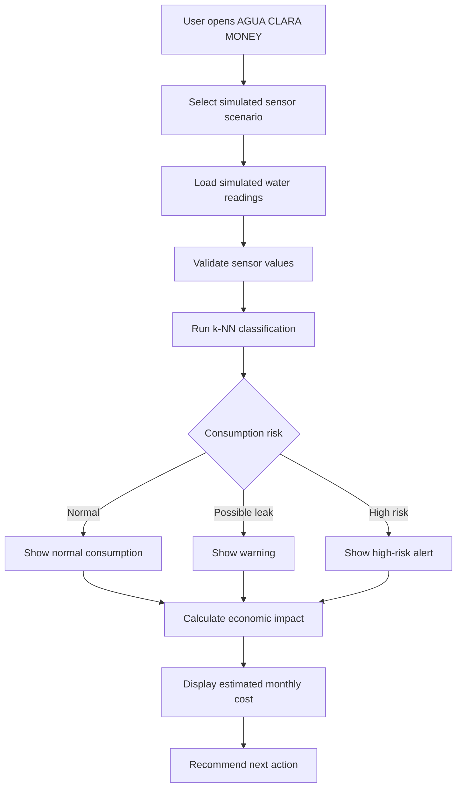
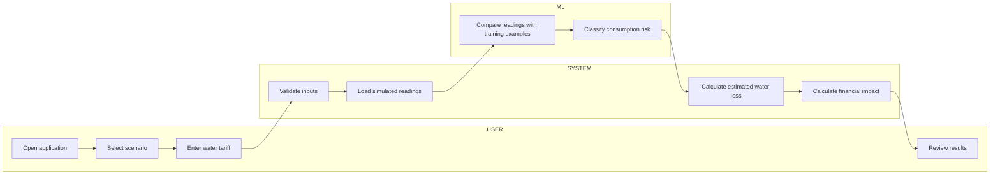

# WEEK 11 — AGUA CLARA MONEY
## Business Bending — When Scarcity Ends
### Role: MONEY

---

# 1. PROBLEM

Water scarcity is not only an environmental problem.
It is also an economic problem.

In Mexico, many households lose money because water leaks
remain undetected for long periods.

Most families do not have access to expensive monitoring
systems or smart water meters.

AGUA CLARA MONEY addresses this problem by making
water consumption visible and translating potential
water losses into understandable financial costs.

The goal is to help families identify possible leaks
and understand their economic consequences.

---

# 2. EXACT USER

Name: Marisol Hernandez

Age: 52

Location: Mexico City

Occupation: Small business owner

Technology experience: Uses WhatsApp and basic mobile apps.

Main problem:
Marisol notices that her water expenses are increasing,
but she does not know whether the cause is a leak
or a change in household consumption.

She needs a simple tool that explains:

- How much water might be wasted.
- How much money that waste represents.
- Whether her consumption pattern is unusual.
- What action she should take next.

---

# 3. SUCCESS DEFINITION

Before the module closes, AGUA CLARA MONEY must allow
a user to:

1. Select a simulated water sensor scenario.
2. View water consumption measurements.
3. Run a Machine Learning classification.
4. Identify possible abnormal consumption.
5. Estimate monthly water losses.
6. Calculate potential economic impact in MXN.
7. Receive a clear recommendation.

Success means that the user can understand the
financial consequences of a possible leak without
requiring technical knowledge.

---

# 4. DRAGON STACK

The application combines three technologies.

## Technology 1: IoT / Sensing

The system uses simulated water meter readings.

Example readings:

Normal consumption: 8 liters/hour

Possible leak: 35 liters/hour

Severe leak: 75 liters/hour

All simulated readings must be clearly labeled.

Future versions could connect to real IoT water sensors.

## Technology 2: Machine Learning

A k-Nearest Neighbors (k-NN) model classifies
consumption patterns.

Possible classifications:

- Normal consumption
- Possible leak
- High-risk leak

The model compares simulated measurements against
a small labeled reference dataset.

The classification is educational and does not
constitute a real leak diagnosis.

## Technology 3: Geodata

The application includes fictional geographic zones.

Geographic information helps demonstrate how
consumption patterns and financial impacts could
vary between different locations.

All geographic examples are fictional and labeled.

## MONEY Layer

The application translates potential water losses
into estimated financial costs.

Illustrative formula:

Monthly water loss (liters) =
Excess consumption (liters/hour) × 24 × 30

Monthly water loss (m3) =
Monthly water loss (liters) / 1000

Estimated monthly cost (MXN) =
Monthly water loss (m3) × Illustrative tariff (MXN/m3)

The tariff is editable by the user.

These calculations are estimates, not official bills.

---

# 5. IMAGE-GENERATED MOCKUP

The proposed interface contains:

- AGUA CLARA MONEY branding.
- Water consumption dashboard.
- Simulated IoT sensor readings.
- Machine Learning risk classification.
- Estimated monthly financial losses.
- Economic savings calculator.
- Recommended next action.

The mockup image is stored separately as:

MOCKUP_CONCEPT.png

The image is a design concept, not evidence
of a deployed application.

---

# 6. MERMAID FLOWCHART

---

# 7. MERMAID SWIMLANE

---

# 8. GLOBAL BENCHMARK

Benchmark:

Flume Water is an existing solution that uses
water monitoring technology to help households
understand water consumption and identify possible leaks.

Reference:
https://flumewater.com

Differentiation:

AGUA CLARA MONEY focuses on an accessible
Mexican educational prototype that translates
simulated water consumption into financial
consequences expressed in Mexican pesos.

Unlike commercial monitoring systems,
this prototype does not require physical hardware.

---

# 9. THREE-YEAR VISION

Within three years, AGUA CLARA MONEY could become
an accessible water monitoring platform for
Mexican households and small businesses.

The system could connect to real IoT sensors,
integrate verified local water tariffs and help
users compare the financial consequences of leaks.

Its long-term objective would be to reduce
information inequality and make water-saving
technology economically accessible.

---

# 10. SCOPE CUT

The current version will NOT include:

- Physical IoT devices.
- Real-time utility company connections.
- Official water billing.
- Payment processing.
- Personal customer accounts.
- Real household consumption records.
- Automatic repair scheduling.
- Real leak diagnosis.

The prototype focuses on one functional,
testable interaction.

---

# 11. ARCHITECTURE

| Component | Technology | Purpose |
|---|---|---|
| Frontend | HTML, CSS, JavaScript | User interface |
| IoT | Simulated sensor readings | Water consumption data |
| ML | k-Nearest Neighbors | Consumption classification |
| Geodata | Fictional zones | Geographic context |
| Finance | JavaScript calculations | Estimated financial losses |
| Hosting | Vercel | Public deployment |
| Version control | GitHub | Development history |

All technologies can be implemented using
free development tools.

---

# 12. TEST PLAN

## Test 1: Normal consumption

Input:
Normal consumption scenario.

Expected result:
Low-risk classification and no abnormal water loss.

## Test 2: Possible leak

Input:
Moderate abnormal consumption.

Expected result:
Warning classification and estimated financial impact.

## Test 3: High-risk leak

Input:
Severe abnormal consumption.

Expected result:
High-risk classification and larger estimated loss.

## Test 4: Invalid tariff

Input:
Negative water tariff.

Expected result:
The application rejects invalid input.

## Test 5: Financial calculation

Input:
Excess consumption = 20 liters/hour

Tariff = 25 MXN/m3

Expected result:

20 × 24 × 30 = 14,400 liters/month

14,400 / 1000 = 14.4 m3/month

14.4 × 25 = 360 MXN/month

## Test 6: Mobile interface

Expected result:
The dashboard remains usable on a mobile screen.

---

# 13. PERSONA TEST PLAN

Synthetic persona:

Marisol Hernandez, 52 years old.

She uses WhatsApp but has limited experience
with technical applications.

The test will evaluate whether Marisol can:

1. Understand the main purpose of the application.
2. Select a simulated scenario.
3. Interpret the risk classification.
4. Understand the estimated financial loss.
5. Identify the recommended next action.

Confusion points will be documented.

The most significant usability issue must be
corrected before the final submission.

A synthetic persona test does not replace
testing with real users.

---

# 14. SECURITY FLOOR

The application must follow these rules:

1. No API keys or secrets in the repository.
2. No real personal data in demonstrations.
3. All inputs must be validated.
4. Simulated sensor data must be labeled.
5. No personal information will be stored.

Because the prototype does not store personal
information, authentication and database
Row Level Security are not required for this slice.

If personal data storage is introduced later,
authentication and access controls must be added.

---

# 15. BLUEPRINT CONDITIONS

The project must be checked against the
team's original Blueprint before final submission.

The declared vacuum and shadow clause
have not yet been verified.

This section must be updated once the
team's conditions are confirmed.

---

# 16. DEVELOPMENT PLAN

Commit 1:
Initialize project repository.

Commit 2:
Create PACKET and architecture documentation.

Commit 3:
Implement simulated IoT readings and ML classification.

Commit 4:
Implement economic impact calculator and interface.

Commit 5:
Fix a documented issue and improve usability.

Deployment 1:
Publish the initial working application.

Deployment 2:
Publish the tested and corrected application.

Both deployments must be documented.

---

# 17. DEFINITION OF DONE

The project is complete when:

- The application works at a public URL.
- The required DRAGON STACK components work.
- Five meaningful commits are documented.
- Two deployments are verified.
- Mechanical tests have been executed.
- At least one bug has been fixed.
- A synthetic persona test has been performed.
- The most significant usability issue has been addressed.
- The security floor has been checked.
- The Blueprint conditions have been verified.
- The demo video has been recorded.
- The development transcript has been exported.

---

# 18. FINAL REFLECTION — MONEY

Technology can reduce the scarcity of information,
but access to economic benefits may remain unequal.

AGUA CLARA MONEY explores how inexpensive sensing
and Machine Learning could help households
understand the financial consequences of water loss.

The central question is not only whether technology
can detect waste, but who can afford to benefit
from that information.
